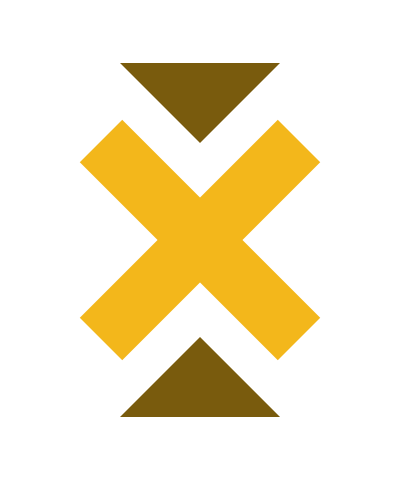

# Missions Log

Adam might *“Never asked for this.”*  
but we did.

---

#### Missions Log is cross-platform build with Qt QML to track missions, tasks and side quests.

| Desktop | Mobile |
| :----------------: | :----------: |
|  |  |

## Key Feature

- A complete semi-transparent background mimicking Adam's HUD
- Add both Main Mission and Side Quests
- New tasks appears once you completed the previous tasks
- Modify and append the new tasks
- Add secondary tasks.
- Set failed in case mission not successful

## Download

You can [download](https://github.com/taaheer/Missions-Log/releases) the latest installable version of Missions Log for Windows, macOS, Linux, and Android.

## Credits

Missions Log was made with:

- [Qt](https://www.qt.io/)
- [QWindowKit](https://github.com/stdware/qwindowkit)

## Support

If you like this project and want to support me, please mail me or contact me through the right channel and discuss how you help me and support me.

## License

GPL-3.0 license
